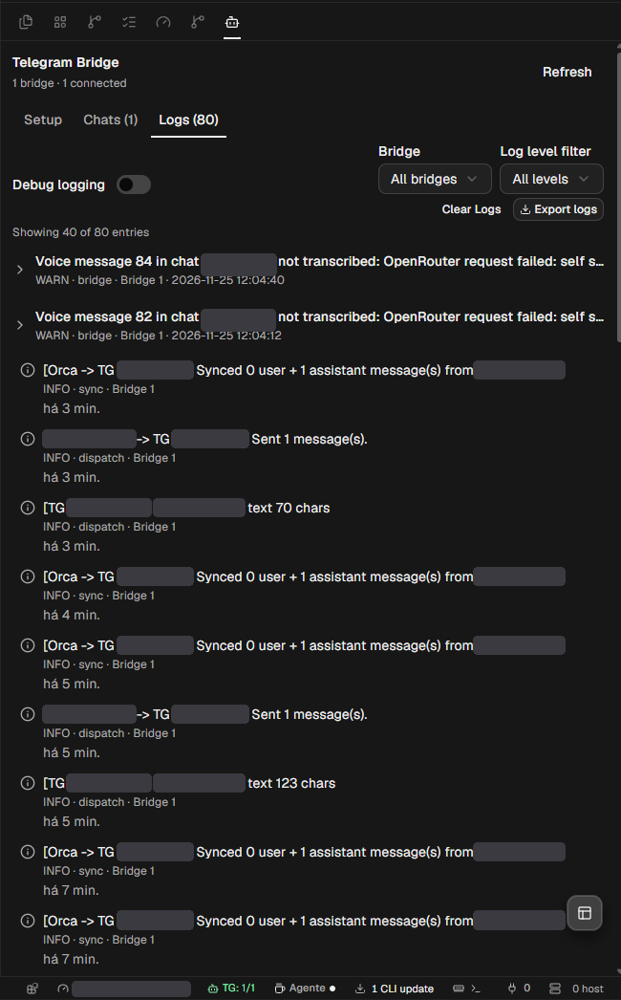

# Telegram Bridge

An Orca `trusted-worker` + `components` sidebar plugin that connects Telegram bots to your local Orca bots for real-time two-way chat. Each **bridge** links one Telegram bot to one Orca bot; run as many bridges as you like.

Fork of the original plugin by [HenryMa96](https://github.com/henryma96/orca-telegram-bridge).

**Talk to your Orca bots from Telegram, from your phone, anywhere.**

- **As many bridges as you need.** Each bridge pairs one Telegram bot with one Orca bot, so `@ci_bot` can front your CI watcher and `@dev_bot` your coding assistant. Every bridge has its own token, access list, language, proxy, group and voice settings, and they all run at once: a bridge that fails never stops the others.
- **Private chats and groups**, open to everyone or restricted to the Telegram user and group IDs you list.
- **Voice messages**, transcribed with OpenRouter or OpenAI and answered as text.
- **Images and files both ways**: photos reach the Orca bot as files, and the Orca bot can send back charts, screenshots and documents; Markdown and tables come back formatted.
- **No server to run**: the plugin long-polls Telegram from inside Orca. No public IP, webhook or extra daemon.

## Features

- **Several bridges**: one Telegram bot per Orca bot (for example `@ci_bot` → `CIWatcher`, `@dev_bot` → `DevHelper`), each with its own token, access list, language, proxy and on/off switch
- **Always-on long polling** (`getUpdates`) inside Orca's worker (no public IP, webhook, or external daemon required)
- **Open or restricted access**: open to everyone while the ID list is empty; add Telegram user or group IDs to restrict it, with one-click **Allow** in the sidebar panel
- **Telegram groups**: in a group the bot answers commands addressed to it, replies to its own messages and, with Telegram privacy mode off, `@yourbot` mentions
- **Encrypted Bot Token storage** via `orca.secrets` (OS keyring)
- **HTTP proxy support** (`proxyUrl` or `HTTPS_PROXY` / `HTTP_PROXY`)
- **Per-chat Orca context binding** — keeps multi-turn conversation history in a dedicated Orca chat per Telegram chat and automatically tracks Orca bot renames by `botId`
- **Telegram → Orca image forwarding** — downloads compressed photos and uncompressed image documents locally and passes their file path(s) to the Orca bot (with optional caption)
- **Orca → Telegram images and documents** — the Orca bot attaches a file by writing ``; the plugin sends it as a photo or document
- **Voice messages**: per bridge, voice messages and audio files are transcribed with OpenRouter or OpenAI and reach the Orca bot as text
- **Optional two-way Orca-side sync** (`syncOrcaOutbound`) — optionally forwards messages you send directly in Orca (and bot replies) from bound chats back to Telegram. Orca's own automation prompts (reminders, deadlines, events, and scheduled runs of an automation that ran in that chat in the last 24 hours) stay in Orca; only the bot's answer goes. Like Orca, a bot answer ending in `NO_REPLY` sends nothing
- **Telegram `/` command menu** (`setMyCommands`) + **interactive inline buttons**: `/help`, `/new`, `/home`, `/bots`, `/use`, `/chats`, `/bind`, `/rename`, `/sync`, `/automations`, `/run`, `/status`
- **Rich Markdown + Table PNG rendering**:
  - Converts Markdown headings, bold, italic, strikethrough, blockquotes, task lists, links, and fenced code blocks to Telegram HTML
  - Renders standard Markdown tables (`| col |`) into crisp PNG images via Python Pillow (`sendPhoto`), automatically falling back to formatted text when Python/Pillow is not installed

## Requirements

- **Orca** `>= 1.4.248`
- **Optional (for table-to-PNG rendering)**: Python 3 with `Pillow` installed (`pip install pillow`)

## Install

Two ways work today: from this GitHub repository (CLI or Orca Settings) and from a local clone. The Orca catalog way is not available yet.

Already using `henryma96.telegram-bridge`? Read [Moving from henryma96.telegram-bridge](#moving-from-henryma96telegram-bridge) first.

| Way | Use it when |
| --- | --- |
| [From this GitHub repository](#from-this-github-repository-recommended) | You want to use the plugin. This is the normal way today. |
| [From the Orca catalog](#from-the-orca-catalog-not-available-yet) | Not available yet. This fork is not listed. |
| [From a local clone](#from-a-local-clone-development) | You want to change the code. |

The plugin key is `drecchia.telegram-bridge`. Orca uses the repository owner (`drecchia`) as the publisher.

**On Linux, Orca's CLI is `orca-ide`.** Plain `orca` there is usually the GNOME screen reader. Replace `orca` with `orca-ide` in every command in this README. On Windows and macOS the command is `orca`.

### From this GitHub repository (recommended)

Orca installs the newest `vX.Y.Z` tag of this repository and pins it to that exact commit:

```sh
orca plugin install drecchia/orca-telegram-bridge
```

To install one exact version, add its tag (see the repository tags):

```sh
orca plugin install drecchia/orca-telegram-bridge@vX.Y.Z
```

**Approve the plugin.** This plugin runs code, so the first run stops with `approval_required` (exit code `3`). Nothing is installed yet. Orca prints:

- what the plugin would be granted and why (its capabilities `storage:own`, `secrets:own`, `settings:own`, plus its panel and commands);
- the publisher (`drecchia`) and the source repository (`github.com/drecchia/orca-telegram-bridge`), because the plugin does not come from Orca's official catalog;
- the exact command to run again with `--approve <fingerprint>`.

Check the list. If you trust it, run the printed command. It looks like this:

```sh
orca plugin install drecchia/orca-telegram-bridge --approve <fingerprint>
```

The fingerprint is bound to this plugin, version, files and access. Installing a different version by hand needs a new fingerprint. Updates that ask for no new access keep the approval (see [Update](#update)).

Without the CLI: in Orca, open **Settings → Plugins**, choose **Add plugin**, then **From a Git URL…**. Paste `https://github.com/drecchia/orca-telegram-bridge#vX.Y.Z`, choose **Install**, review the access, then enable it.

### From the Orca catalog (not available yet)

When the plugin is listed on [orca.dev/plugins](https://orca.dev/plugins), you can install it by id:

```sh
orca plugin install drecchia.telegram-bridge
```

Today this does not work. This repository is a GitHub fork of [HenryMa96/orca-telegram-bridge](https://github.com/henryma96/orca-telegram-bridge), and the directory leaves forks out ([Add your plugin](https://orca.dev/plugins/add)). The current status is on [orca.dev/plugins/drecchia/orca-telegram-bridge](https://orca.dev/plugins/drecchia/orca-telegram-bridge). Use the GitHub install above. After listing, the approval step is the same. Existing GitHub installs keep updating from GitHub; you do not need to switch.

### From a local clone (development)

Load the working folder as a development plugin:

```sh
git clone https://github.com/drecchia/orca-telegram-bridge.git
cd orca-telegram-bridge
orca plugin dev load . --json
```

The first load also stops with `approval_required` (exit code `3`). Run it again with the printed fingerprint:

```sh
orca plugin dev load . --approve <fingerprint> --json
```

Orca reloads the plugin when its files change. Code edits run without a new approval. New access needs one. If Orca missed a change, reload by hand:

```sh
orca plugin dev reload . --json
```

To remove the development copy, run `orca plugin dev unload .`. For checks and releases, see [PUBLISHING.md](./PUBLISHING.md).

### Update

- GitHub install: run `orca plugin update drecchia.telegram-bridge`, or run the install command again with the new `@vX.Y.Z` tag. If the new version asks for more access, Orca stops with `approval_required` and keeps the running version. Run the printed `--approve <fingerprint>` command.
- Local clone: `git pull`, then `orca plugin dev reload . --json`.

### Moving from `henryma96.telegram-bridge`

The upstream plugin has the key `henryma96.telegram-bridge`. This fork has a different key, so Orca treats it as a different plugin. The bot token, settings and stored data do not carry over.

1. Remove the old plugin. If you installed it from GitHub or the catalog, run `orca plugin uninstall henryma96.telegram-bridge`. If you loaded a local folder (upstream's Setup step), run `orca plugin dev unload <that folder>`. Two copies that poll the same bot token conflict.
2. Install this fork (see above).
3. Do the [Setup](#setup) steps again.

## Setup

Do these steps after the plugin is installed and approved. Repeat steps 2–7 for each Telegram bot you want to connect.

1. Open the **Telegram** sidebar panel in Orca. The **TG** item in Orca's status bar shows the bridges' state (`TG: 2/2` = 2 of 2 active bridges connected); click it to open this panel.
2. In the Setup tab, click **Edit** on a bridge, or **Add bridge** for a new one. A bridge is shown by its Telegram bot's `@username` ("New Telegram bot" until its token is checked). An update from 0.4.0 or older already has one bridge with your previous settings.
3. **Connection:** paste the `@BotFather` bot token. Each Telegram bot token can belong to one bridge only.
4. Choose the **Orca bot** this Telegram bot talks to, or keep **(Auto-select first Orca bot)**. The list shows the bots on this computer (the folders in `~/.orca/bots`). The Telegram bot talks only to this Orca bot; `/use` cannot switch it.
5. **Who can talk:** choose **Only these people and groups** and type the IDs, or **Anyone on Telegram**. See [Who can talk to the bot](#who-can-talk-to-the-bot).
6. Click **Save**, then **Test connection**. The **Active** switch on the bridge's card turns it on or off at once; no Save needed.
7. Optional: **Groups** (see [Use the bot in a group](#use-the-bot-in-a-group)), **Features** (voice messages, Orca-side sync) and **Advanced**, closed by default: the **Telegram reply language** (English, Português (Brasil) or 中文) for the bot's own replies and command menu, the reply timeout, an HTTP proxy (e.g. `http://127.0.0.1:7890`) and the transcription model. The Orca bot's answers keep the language the Orca bot writes in.

To remove a bridge, open its editor, click **Remove**, then **Confirm remove**. Orca forgets its token and its chats; its log entries stay in the Logs tab.

Why not a connector inside Orca's **Bot settings → Connectors**? A plugin cannot add connectors there: Orca's connectors (Slack, Linear, GitHub, Google, Webhook) are built in. A native Telegram connector is requested upstream in [stablyai/orca#45959](https://github.com/stablyai/orca/issues/45959).

## Who can talk to the bot

Each bridge has its own **Who can talk** choice (Setup tab → the bridge's **Edit**). Access to one Telegram bot says nothing about another:

- **Anyone on Telegram: open to everyone.** Any Telegram user who finds your bot, and any group it is in, can use it. The panel shows an **Open to everyone** warning on the card.
- **Only these people and groups: restricted.** Only the listed IDs can use the bot. A user ID allows that person in private chats and in any group. A group ID (a negative number, e.g. `-1001234567890`) allows every member of that group. Saving this choice needs at least one ID.

Every person who can use the bot uses its Orca bot with your rights: they can chat with it, list and bind that Orca bot's existing chats (`/chats`, `/bind`) and run automations. Keep the bot open only if you accept that, or restrict it.

[Orca → Telegram sync](#features) works only with a restricted list. While the bot is open to everyone, sync is paused, so a stranger who binds one of your Orca chats does not receive what you write in Orca.

### Restrict access

1. Ask each person to send any message to the bot (in a group, mention the bot).
2. While the bot is open, it answers them. To restrict it, add at least one ID: your own first. Your ID: send a message to the bot, then read it in the panel's **Chats** tab (`TG <ID> -> …`), or ask a bot such as `@userinfobot`.
3. Choose **Only these people and groups**, type the IDs separated by commas or spaces, and click **Save**.

Once the list is restricted, an unknown person gets one short reply with their Telegram ID (at most once a minute), and the panel shows a banner: `User <ID> messaged your bot but is not in the allowlist.` Click **Allow \<ID\>** to add them. The banner shows only the latest unknown person.

Removing an ID stops the bot from answering that person or group, and stops sync to their chats. Choosing **Anyone on Telegram** opens the bot to everyone again.

### Use the bot in a group

Groups are off for a new bridge. Choose per bridge in the Setup tab → the bridge's **Edit** → **Groups**:

- **Off**: the bot ignores group messages. If someone adds it to a group, it leaves the group at once and the Logs tab says so.
- **Only messages for the bot**: commands addressed to it (`/help@yourbot`), replies to its messages and, with privacy mode off, `@yourbot` mentions. The mention is removed before the text goes to the Orca bot. Normal conversation in the group is ignored.
- **All messages**: every message an allowed person writes in the group goes to the Orca bot, so it follows the whole conversation. One more choice appears, **Replies**:
  - **Only when addressed** (default for a new bridge): the bot answers only messages for it (a mention, a reply to the bot, a command for it). Other messages only give it context; the bridge never posts an answer to them.
  - **When it can help**: the bot may also answer a message not addressed to it, when it can clearly help; otherwise it stays silent (`NO_REPLY`).

  Each group message starts one Orca bot turn, so a busy group costs more. Messages not addressed to the bot never get a typing indicator or an error line in the group; problems go to the Logs tab. **All messages** works only with **Only these people and groups**; while the bridge is open to everyone, the bot reads only messages for it, so strangers in a busy group cannot start an Orca run with every line.

A bridge updated from 0.4.0 or older starts with **Only messages for the bot**, the behavior it had before. A bridge that already used **All messages** before 0.8.0 starts with **When it can help**, so it keeps answering in the group; choose **Only when addressed** to make it answer only messages for it.

Telegram decides two things that the plugin cannot change. Set them for the bot in `@BotFather`; after the bot has connected once, the bridge's editor warns under **Groups** when one of them blocks the option you chose:

- **Allow Groups?** (`/setjoingroups`): must be enabled, or Telegram refuses to add the bot to a group.
- **Privacy mode** (`/setprivacy`; [Telegram: privacy mode](https://core.telegram.org/bots/features#privacy-mode)): on by default. While it is on, the bot receives only commands addressed to it and replies to its own messages: `@yourbot` mentions and **All messages** do not work. Choose **Disable**, then remove the bot from the group and add it again; Telegram applies the change only then. A bot that is a group admin receives every message either way.

Then:

1. Add the bot to the group in Telegram (group menu → **Add members**).
2. Talk to it as the **Groups** option allows.
3. To restrict access to this group, add the group's ID under **Only these people and groups**. The group's ID appears in the **Chats** tab (`TG -100… -> …`) after the bot answers there once. In restricted mode, a blocked group message also logs it in the **Logs** tab: `Blocked unauthorized Telegram user <ID> (…) in group -100…`.

In a group, everyone sees the bot's replies, and the whole group shares one Orca chat: `/new`, `/bind` and `/home` change it for everyone in that group.

## Voice messages

Orca bots run agent CLIs that read text, so the plugin transcribes voice messages first. Turn it on per bridge in the Setup tab → the bridge's **Edit**:

1. Switch on **Voice messages**.
2. Choose the **Transcription provider**:
   - **OpenRouter**: one key for several speech-to-text models; default model `openai/whisper-large-v3`. Key from [openrouter.ai/keys](https://openrouter.ai/keys).
   - **OpenAI**: default model `gpt-transcribe`. Key from [platform.openai.com/api-keys](https://platform.openai.com/api-keys).
3. Optional: another **Transcription model** of that provider. Leave it empty for the default.
4. Paste the **Transcription API key** and click **Save**. Orca keeps it encrypted, like the bot token.

Then a voice message, or an audio file (mp3, m4a, ogg, wav, flac, webm), reaches the Orca bot as `[Voice message, transcribed] <text>`, after the caption if there is one. The bot answers the text; the transcript is not posted back to Telegram and never written to the logs.

- The audio goes to the chosen provider, which charges per minute of audio. Files over 20 MB are refused: Telegram does not let a bot download larger files.
- The bridge's HTTP proxy, when set, is used for the transcription too.
- With **Voice messages** off, or on without a key, the sender gets a short reply that voice messages are not enabled for this bot.
- If the transcription fails, the sender gets a short reply with the reason, and the Logs tab has the details.

## Images and files from the Orca bot

An Orca bot can only answer in text, so the plugin gives it a convention: to send an image or a file, the bot writes it on its own line as

```markdown

```

The plugin tells the Orca bot about this in every message, takes those lines out of the reply, sends the text, then sends each file with its caption. It works for direct replies and for [Orca → Telegram sync](#features).

- **Images** (PNG, JPEG, GIF, WEBP) go as photos. The plugin checks the file's content, not only its extension. A photo Telegram refuses (too large or too long) goes again as a file.
- **Documents**: PDF, CSV, TSV, TXT, MD, XLSX, XLS, DOCX, DOC, PPTX, PPT, ODT, ODS, ODP.
- **https links** to images or documents: Telegram downloads them itself, so nothing leaves your computer.
- Limits from Telegram: photos up to 10 MB (5 MB by link), documents up to 50 MB (20 MB by link).
- A file that is missing, too large or not allowed is not sent; the chat gets one short line with the file name (never the full path) and the reason.

**Files from your computer are sent only when the bridge is restricted** to [Only these people and groups](#who-can-talk-to-the-bot). While the bot is open to everyone, a file reference gets a short "only when restricted" line instead, so a stranger cannot ask the bot for your files; https links still work. The same rule already applies to Orca → Telegram sync and to group **All messages**.

Even when restricted, the Orca bot reads files with your rights, and an allowed person can ask it for one. The plugin always refuses files in credential folders (`.ssh`, `.gnupg`, `.aws`, `.azure`, `.kube`, `.docker`, `.config/gcloud`) and `.env` files, even through a shortcut or link, and sends only the image and document types above. Allow only people you trust if the bot can see private documents.

## Telegram Commands

| Command | Description |
| --- | --- |
| `/help` | Show current target bot, session ID, sync status, and command list |
| `/new` | Reset current chat binding and start a fresh Orca session |
| `/home` | Bind Telegram chat to the current bot's Home Chat |
| `/bots` | List all available Orca bots with inline switch buttons |
| `/use <name>` | Switch target Orca bot |
| `/chats` | List recent active Orca chats with inline bind/new/home buttons |
| `/bind <chatId>` | Bind Telegram chat to an existing Orca chat |
| `/rename <title>` | Rename the currently bound Orca chat |
| `/sync [on\|off]` | Toggle or set Orca → Telegram outbound sync |
| `/automations` | List Orca automations with inline run buttons |
| `/run <id>` | Trigger an Orca automation immediately |
| `/status` | Show Telegram bot, target Orca bot, session, sync, and polling status |

## Debugging

- The **Logs** tab lists the newest 40 of up to 200 stored entries. Filter by level (all, errors, warnings and errors, debug only). Entries with details expand to show the error context: Orca CLI args, exit code and stderr; Telegram method, HTTP status and description; chat ids, timings and the top of the stack.
- Turn on **Debug logging** in the Logs tab (or the `debugLogging` setting, off by default) to also record `debug` entries: Telegram and Orca CLI calls with timings, dispatch start/finish, sync ticks that forward something, config changes (field names only), poll loop start/stop/backoff and errors that were ignored before. Turn it off again when done; errors and warnings keep their details either way.
- Error `self-signed certificate in certificate chain`? See [Troubleshooting](#self-signed-certificate-in-certificate-chain).
- Every message and detail is redacted: the bot token and any `bot<digits>:<secret>` pattern become `bot<redacted>`. Message text from users and bots is never logged, only lengths and ids.
- For a bug report, click **Export logs**. It saves a text file with a diagnostics header (plugin version, platform, Node version, resolved `orca` CLI path, status, config without the token, bot and binding counts) and every stored entry with its details.

## Troubleshooting

### `self-signed certificate in certificate chain`

<p align="center">
  
</p>

**What it means.** Something between your computer and the service re-signs HTTPS with its own certificate: antivirus HTTPS scanning (Kaspersky, ESET, Avast, Bitdefender…), a VPN, or a corporate proxy. Your operating system (Windows, macOS or Linux) trusts that certificate, so your browser works, but the Node runtime inside Orca has its own certificate list and refuses it. The scanner may pick some sites only; with Kaspersky on Windows we saw `openrouter.ai` intercepted while `api.telegram.org` and `api.openai.com` were not.

**What the plugin does.**

- **Voice transcription** (OpenRouter, OpenAI) trusts your operating system's certificate store (Windows, macOS or Linux) as well as Node's, like a browser, so it works through the scanner. The transcription API key then passes through the scanner.
- **Telegram** keeps Node's own list on purpose, because every Telegram request carries the bot token. If the scanner intercepts `api.telegram.org`, the bridge stops with this error instead of handing the token to the scanner.

**Bypass: exclude the hosts from HTTPS scanning.** This fixes Telegram, and keeps the transcription key out of the scanner too. Exclude:

```text
api.telegram.org
openrouter.ai
api.openai.com
```

In **Kaspersky** Standard, Plus or Premium ([Kaspersky: encrypted connections settings](https://support.kaspersky.com/kaspersky-for-windows/21.28/157530)):

1. Open Kaspersky and click **Settings** (the gear at the bottom).
2. Go to **Security settings**, then click **Network settings** in the **Advanced settings** block.
3. Open **Encrypted connections scan** and click **Configure trusted addresses**.
4. Click **Add**, type `api.telegram.org`, click **Add**. Repeat for `openrouter.ai` and `api.openai.com`.

Other antivirus products call the same setting HTTPS scanning, SSL/TLS filtering or web protection exclusions. Behind a corporate proxy, ask IT to exclude these hosts from TLS inspection.

Then send the Telegram message or voice message again. The Logs tab shows the result.

## Develop & Release

To work on the code, use the [local clone install](#from-a-local-clone-development). [PUBLISHING.md](./PUBLISHING.md) is the full runbook: the pre-release audit, the checks (`orca plugin validate`, `test`, `check`, `release-entry`), tagging a `vX.Y.Z` release, and the catalog listing status.

## License

[MIT](./LICENSE)
